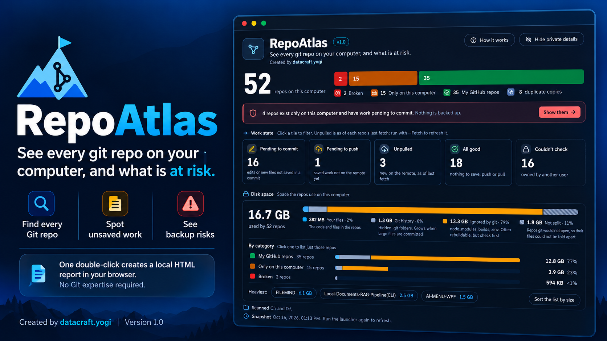
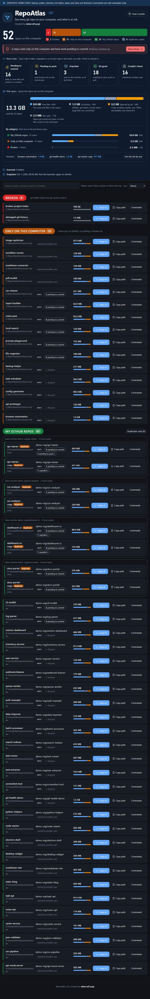
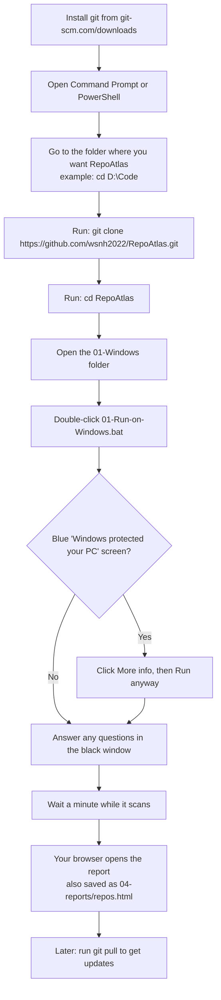
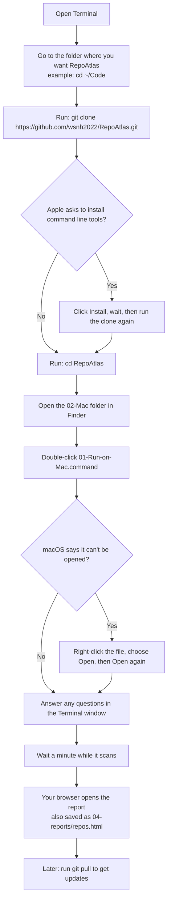

# RepoAtlas

**See every git repo on your computer, and what is at risk.**

Created by **datacraft.yogi**. Version 1.0.

RepoAtlas is one page that shows the state of every git project on your computer, so nothing important is left unsaved, unbacked-up or forgotten.

You do not need to know git to use it. Double-click one file, wait a minute, and your browser opens a report that tells you in plain words which projects are safe and which need attention.

---

## 1. Why this exists

Git can tell you the state of **one** project at a time. Nothing tells you the state of **all** of them.



Over the years, code spreads across folders, drives and half-forgotten experiments. To know whether any of it is at risk, you would have to open every folder and run several commands in each. Almost nobody does, so problems stay hidden until the day a laptop dies, a disk is wiped or a folder is deleted by mistake, and work that only ever lived on that computer is gone.

RepoAtlas does that checking for every project in one pass and puts the answer on one page.

### The worries it answers

| The worry | Where the report answers it |
|---|---|
| "How many projects do I have, and where are they?" | The total at the top, grouped by where each project stands, with its folder shown |
| "Is this project backed up anywhere, or only on this computer?" | The **Only on this computer** group |
| "I changed files and forgot to save them in a commit." | **Pending to commit**, with how many files |
| "I committed, so it must be on GitHub." (Often it is not.) | **Pending to push**: saved work that GitHub does not have yet |
| "Another computer or a teammate added work and I do not have it." | **Unpulled**: new work on the remote that you do not have |
| "I cloned the same project twice. Which copy is the real one?" | **Duplicate copies**, plus a ready-made command that shows which copy is newest |
| "Which projects are mine, which belong to others, which are on GitLab?" | **My GitHub repos**, **Someone else's repo**, **On another site** |
| "A folder looks fine but git cannot read it." | **Broken**, listed on its own |
| "How much space does each project take, and what is using it?" | The **size** on every project, split into your files, git history and ignored folders such as `node_modules`. **Sort > Largest first** puts the biggest on top |
| "Is it safe to reinstall, wipe, switch computers or delete this folder?" | **All good** means nothing is pending. Anything else is a reason to look first |
| "I can see the problem but I do not remember the command." | The **Commands** button on each project shows commands already filled in for it, ready to copy |
| "I want to share a screenshot without exposing my names and folders." | **Hide private details**, or a shareable copy of the report |

### Good moments to run it

- Before you reinstall Windows or macOS, wipe a drive or move to a new computer.
- Every so often, as a check that nothing important lives only on this computer.
- When cleaning up old folders, to see which ones are safe to delete.
- When you cannot remember which copy of a project is the up-to-date one.

---

## 2. Quick start

1. **Get the folder on your computer.** Pick one:

   - **Clone it with git** (needs [git](https://git-scm.com/downloads) installed). Open a terminal (Command Prompt or PowerShell on Windows, Terminal on Mac), go to the folder where you want it, and run:

     ```
     git clone https://github.com/wsnh2022/RepoAtlas.git
     cd RepoAtlas
     ```

     To get later updates, run `git pull` inside that folder.
   - **Or download the zip** from the GitHub page (green **Code** button, then **Download ZIP**) and unzip it anywhere. Do not run it from inside the zip.

2. **Open the folder for your computer and double-click the one launcher inside.**

   | Your computer | Open this folder | Double-click |
   |---|---|---|
   | Windows | `01-Windows/` | `01-Run-on-Windows.bat` |
   | Mac | `02-Mac/` | `01-Run-on-Mac.command` |

3. **Answer any questions in the window that opens.** The first run may offer to install helper tools (git, fd, gh). It always asks first, and you can say no.
4. **Read the report.** It opens in your browser and is also saved as `04-reports/repos.html`.

Stuck? Open `01-Windows/02-Windows-help.md` or `02-Mac/02-Mac-help.md`.

### Step by step: Windows



### Step by step: Mac



---

## 3. How to read the report

The top of the report reads in three steps, from the big picture down to the detail.

### Step 1: Backup status

The big number is how many projects were found. The coloured bar splits them by where they stand. **Click any colour to show only those projects.**

| Group | What it means |
|---|---|
| **My GitHub repos** | Connected to a GitHub project owned by you |
| **Someone else's repo** | A copy of another person's GitHub project |
| **On another site** | Connected to GitLab, Bitbucket or a private server |
| **Only on this computer** | Not connected to any remote. If this computer fails, it is gone |
| **Broken** | The project's git data is damaged and git cannot read it |
| **Duplicate copies** | The same project kept in more than one folder (click it to list them) |

### Step 2: Start here

One line names the most urgent problem, for example: *"2 repos exist only on this computer and have work pending to commit. Nothing is backed up."* Click it to see those projects. If everything is fine, it says so.

### Step 3: Work state

Each tile is a filter. Click one to list the projects behind it. Tiles combine with colours, for example **Only on this computer** plus **Pending to commit**.

| Tile | In plain words | Git calls it |
|---|---|---|
| **Pending to commit** | You changed or added files, but they are not saved in a commit yet | uncommitted |
| **Pending to push** | Saved on this computer, but not yet uploaded to the remote | unpushed |
| **Unpulled** | New work is on the remote that you do not have yet | behind |
| **All good** | Nothing pending to commit or push, and nothing unpulled | clean |
| **Couldn't check** | Git could not read the project (owned by another user, too slow, or unreadable). The tile gives the reason | |

Active filters appear as small chips next to the search box. Click a chip's **x** to remove it, or **Clear all** to start over.

On each project, small tags show the same information, such as `3 pending to commit`. Hover any tag for a plain-English explanation. The **How it works** button at the top has a short version of this page.

### Size on disk

The **Disk space** card under the tiles shows the grand total, a bar that splits it into the parts below, a **By category** list (how much space My GitHub repos, Only on this computer, Someone else's repo and the others each use; click one to list just those repos), the three heaviest projects and a **Sort the list by size** button. Every project also shows its own size with a small bar split the same way:

| Colour | What it is |
|---|---|
| Blue | **Your files**: the project itself |
| Grey | **Git history**: the hidden `.git` folder where git keeps every past version. It grows when large files are committed |
| Amber | **Ignored by git**: things git is told to skip, such as `node_modules`, build output and `.env` files. Usually they can be recreated, but not always (a `.env` or a local database cannot), so check before deleting |

Hover a size, or open **Commands**, to see the exact numbers. Use **Sort > Largest first** next to the search box to find what is using the most space. If a project was too big to finish measuring in a minute, its size is shown as "at least" (≥).

Sizes add up the bytes in each file, like the size Explorer and Finder show for a folder. The space the drive really reserves can be a little higher.

> **Unpulled is only as fresh as the project's last fetch.** Run with `-Fetch` to refresh it first (this needs the internet and takes longer).

---

## 4. What it will and will not do

**It will**
- Read each project's state and size and show them on one page.
- Ask before installing anything, and remember your answers.
- Remove any password or token found inside a remote address before it reaches the report.
- Keep the report as a single local file. The tool does not upload your project list anywhere.

**It will not**
- Commit, push, edit or delete anything in your projects. It only reads. The commands in the Commands panel are for you to copy and run yourself.
- Change system policies or security settings.
- Ask for or store your passwords.

**Good to know**
- The report is a snapshot of the moment it was made. Run the launcher again to refresh it.
- Windows scans every fixed drive. Mac scans your home folder. External and network drives are scanned only if you name them with `-Root`.
- Projects where `.git` is a file (worktrees and submodules) are not listed.

---

## 5. Sharing a screenshot or the report safely

Your report contains real project names, folders and account names. Two ways to share it without exposing them:

- **For a screenshot:** in the report, press **Hide private details** (top right). Names, folders and accounts turn into placeholders such as `repo-04` and `folder-02`. Take your screenshot, then press **Show real details** to switch back. The browser's address bar can still show your username, so crop to the page.
- **For sending the file:** double-click `03-Make-shareable-report` in your computer's folder. It writes `04-reports/repos-shared.html`, which contains no real values at all. **Send that file, not `repos.html`.**

---

## 6. Folder map

The numbers show the order you will use things in.

```
repoatlas/
├── README.md                         <- you are here
├── 01-Windows/
│   ├── 01-Run-on-Windows.bat         <- double-click (Windows)
│   ├── 02-Windows-help.md
│   └── 03-Make-shareable-report.bat  <- double-click for a copy safe to share
├── 02-Mac/
│   ├── 01-Run-on-Mac.command         <- double-click (Mac)
│   ├── 02-Mac-help.md
│   └── 03-Make-shareable-report.command  <- double-click for a copy safe to share
├── 03-my-settings/                   <- the only folder you edit
│   └── 01-repoatlas.config.example.json
├── 04-reports/                       <- created on each run
│   ├── repos.html                    <- your report
│   └── repos-shared.html             <- shareable copy, made by the 03 launcher
├── 05-docs/
│   └── 01-full-guide.md
└── 99-app/                           <- the program itself, last because nobody opens it
    └── repoatlas.ps1
```

| Folder | What it is | Do you touch it? |
|---|---|---|
| `01-Windows/` | Windows launcher and Windows tips | Only to run it |
| `02-Mac/` | Mac launcher and Mac tips | Only to run it |
| `03-my-settings/` | Your optional settings | **Yes, the only place you edit** |
| `04-reports/` | The report, created on each run | No |
| `05-docs/` | Full guide: every option, troubleshooting | Read when needed |
| `99-app/` | The program | No |

A few files keep plain names because the program looks them up by name: `repoatlas.config.json` (your settings), `repoatlas.ps1` and `repos.html`.

---

## 7. Common options

Optional. Add them after the launcher name in a terminal window. The full list is in `05-docs/01-full-guide.md`.

| Option | What it does |
|---|---|
| `-Root D:\Code` | Scan only this folder (separate several with commas) |
| `-Fetch` | Refresh each project from its remote first, so **Unpulled** is current |
| `-NoStatus` | Skip the work-state check (faster, but the report has no work state) |
| `-NoSize` | Skip measuring disk space (faster on very large drives) |
| `-IgnoreUntracked` | Do not count brand-new files that were never added to git |
| `-Redact` | Write the shareable copy only |

To make an option permanent, copy `03-my-settings/01-repoatlas.config.example.json` to `03-my-settings/repoatlas.config.json` and edit it.

---

## 8. Git words in plain English

| Word | Meaning |
|---|---|
| **Repo** (repository) | A project folder that git is tracking |
| **Commit** | A saved snapshot of your changes, kept in git's history |
| **Remote** | A copy of the project on another server, usually GitHub |
| **Push** | Upload your commits to the remote |
| **Pull** | Download new commits from the remote |
| **Fetch** | Check the remote for news without changing your files |
| **Branch** | A separate line of work inside one project |

---

RepoAtlas 1.0, created by **datacraft.yogi**.
